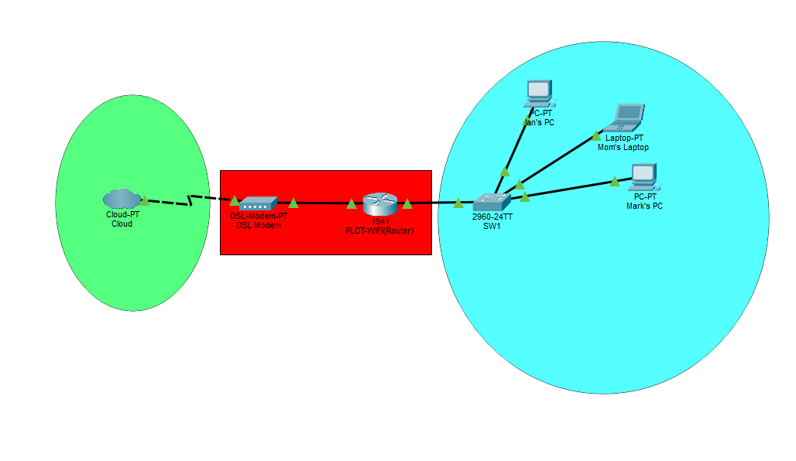

# 🌐 SOHO Home Network Simulation (Cisco Packet Tracer)

A simulated Small Office / Home Office (SOHO) network built in **Cisco Packet Tracer**. This project demonstrates dual-subnet IPv4 addressing, Layer 2 switching, Layer 3 inter-subnet routing, automated DHCP IP allocation, and end-to-end ICMP connectivity verification.



---

## 🏗️ Architecture & Hardware Used

* **Router:** Cisco 1941 ISR (`PLDTWIFI`) — Handles WAN/LAN routing and DHCP server leases.
* **Switch:** Cisco Catalyst 2960-24TT (`SW1`) — Performs Layer 2 frame forwarding across VLAN 1.
* **Modem / ISP:** DSL Modem connected to ISP Cloud (`192.168.10.0/24` WAN segment).
* **Endpoints:** 3 client machines (`Ian's PC`, `Mom's Laptop`, `Mark's PC`) receiving dynamic IPs via DHCP.

---

## 📋 IP Addressing & Interface Table

| Device | Interface | IPv4 Address | Subnet Mask | Default Gateway | Role |
| :--- | :--- | :--- | :--- | :--- | :--- |
| **PLDTWIFI (1941)** | `GigabitEthernet0/0` | `192.168.10.1` | `255.255.255.0` | N/A | WAN Uplink to DSL Modem |
| **PLDTWIFI (1941)** | `GigabitEthernet0/1` | `192.168.1.1` | `255.255.255.0` | N/A | LAN Default Gateway |
| **SW1 (2960)** | `Gig0/1`, `Fa0/1–4` | `Unassigned` | N/A | N/A | Layer 2 Access Ports (VLAN 1) |
| **Ian's PC** | `FastEthernet0` | `192.168.1.2` *(DHCP)* | `255.255.255.0` | `192.168.1.1` | LAN Client |
| **Mom's Laptop** | `FastEthernet0` | `192.168.1.3` *(DHCP)* | `255.255.255.0` | `192.168.1.1` | LAN Client |
| **Mark's PC** | `FastEthernet0` | `192.168.1.4` *(DHCP)* | `255.255.255.0` | `192.168.1.1` | LAN Client |

---

## ⚙️ Device Configurations (Cisco IOS)

### 1. Cisco 1941 Router (`PLDTWIFI`)

```ios
enable
configure terminal
hostname PLDTWIFI

! Configure WAN Interface (Modem Side)
interface GigabitEthernet0/0
 description WAN_TO_MODEM
 ip address 192.168.10.1 255.255.255.0
 no shutdown
 exit

! Configure LAN Interface (Switch / Default Gateway Side)
interface GigabitEthernet0/1
 description LAN_DEFAULT_GATEWAY
 ip address 192.168.1.1 255.255.255.0
 no shutdown
 exit

! Configure DHCP Server Pool
ip dhcp excluded-address 192.168.1.1
ip dhcp pool HOME_LAN_POOL
 network 192.168.1.0 255.255.255.0
 default-router 192.168.1.1
 dns-server 8.8.8.8
 end

! Save Configuration
copy running-config startup-config
```

### 2. Cisco 2960 Switch (`SW1`)

```ios
enable
configure terminal
hostname SW1

! Configure Router Uplink Port
interface GigabitEthernet0/1
 description UPLINK_TO_PLDTWIFI_ROUTER
 switchport mode access
 switchport access vlan 1
 no shutdown
 exit

! Configure End-Device Access Ports
interface range FastEthernet 0/1 - 4
 switchport mode access
 switchport access vlan 1
 no shutdown
 end

! Save Configuration
copy running-config startup-config
```

---

## ✅ Verification & Testing Outputs

### 1. Router Interface Status (`show ip interface brief`)

```text
PLDTWIFI# show ip int brief
Interface              IP-Address      OK? Method Status                Protocol 
GigabitEthernet0/0     192.168.10.1    YES manual up                    up 
GigabitEthernet0/1     192.168.1.1     YES manual up                    up 
Vlan1                  unassigned      YES unset  administratively down down
```

### 2. Switch MAC Address Table (`show mac address-table`)

```text
SW1# show mac address-table
          Mac Address Table
-------------------------------------------

Vlan    Mac Address       Type        Ports
----    -----------       --------    -----
   1    0007.ec1e.1aa5    DYNAMIC     Fa0/4
   1    000a.f3d5.4a02    DYNAMIC     Gig0/1
   1    0030.a3b4.c974    DYNAMIC     Fa0/2
```

### 3. End-to-End ICMP Ping Verification

Executed from **Ian's PC** (`192.168.1.2`):

* **Default Gateway (`ping 192.168.1.1`):** `4/4` replies received (`0%` loss) — confirms PC-to-Switch and Switch-to-Router LAN connectivity.
* **Router WAN (`ping 192.168.10.1`):** `4/4` replies received (`0%` loss) — confirms inter-subnet packet forwarding across the router.
* **Peer LAN Hosts (`ping 192.168.1.3` / `192.168.1.4`):** `4/4` replies received (`0%` loss) — confirms Layer 2 switching across VLAN 1.

---

## 💡 Key Engineering Takeaways

* **Subnet Isolation:** Router interfaces require distinct IP subnets (`192.168.10.0/24` on WAN vs. `192.168.1.0/24` on LAN) to route traffic without overlapping subnet conflicts.
* **Layer 2 vs. Layer 3 Behavior:** Physical access ports on the 2960 switch remain `unassigned` at Layer 3 while forwarding Ethernet frames via dynamic MAC learning at Layer 2.
* **Centralized DHCP Management:** Configuring the DHCP server pool on the gateway router automates IP, subnet mask, gateway, and DNS assignment for any client connected to the switch's VLAN 1 access ports.

---

## 🚀 How to Run Locally

1. Download [`HomeNetwork-Bornas.pkt`](HomeNetwork-Bornas.pkt) from this repository.
2. Open the file using **Cisco Packet Tracer 9.0.1** (or newer).
3. Open any client PC → **Desktop** → **Command Prompt** and run `ipconfig` or `ping 192.168.1.1`.
